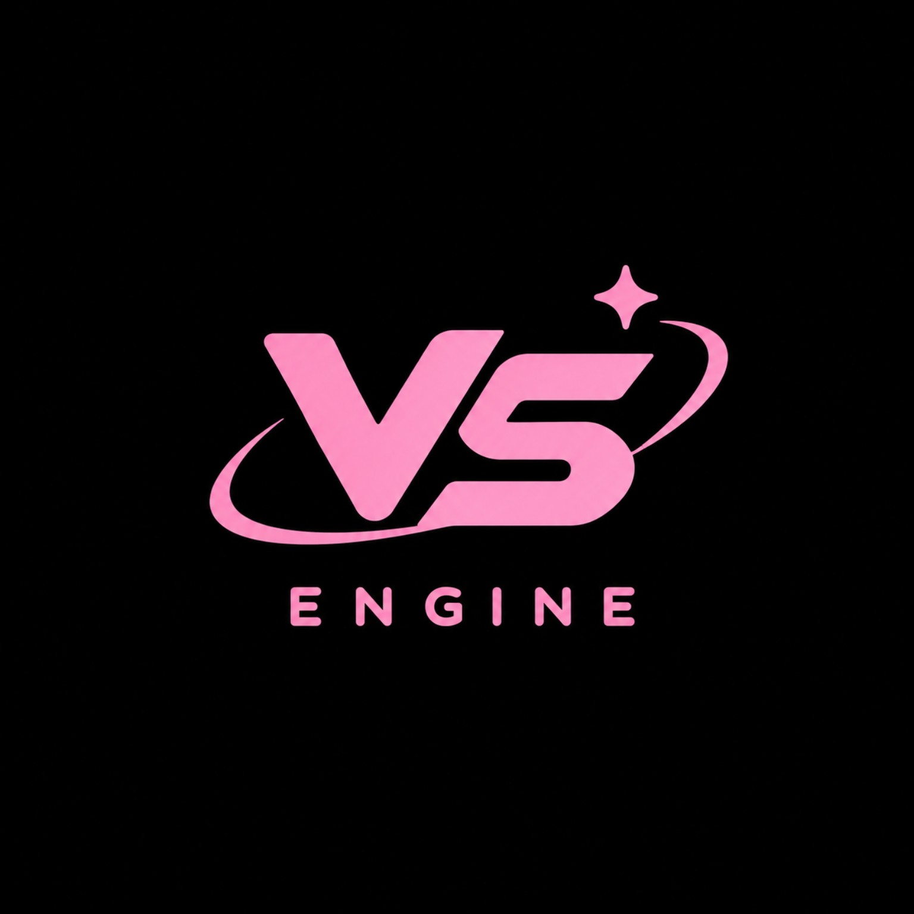

<div align="center">



# VS Engine

### A 3D Game Engine Project by Viana Studio

**A pink-on-black identity. A big 3D vision. Built one real system at a time.**

[](#-about-the-project)
[](#-vision)
[](#-graphics-architecture)
[](#-platform-goals)

**VS Engine** is an ambitious 3D engine project focused on real-time graphics, modern rendering architecture, efficient resource management, and a developer-friendly workflow. Its long-term vision is to explore capabilities associated with high-end engines such as Unreal Engine 5 while building and validating each subsystem incrementally.

> **Project status:** This repository is the home for the engine's development. Features listed as goals or planned systems below are not claims that they are already implemented. Update the status table as each feature is built and tested.

</div>

---

## 📑 Table of Contents

- [✨ About the Project](#-about-the-project)
- [🎯 Vision](#-vision)
- [🧭 Design Principles](#-design-principles)
- [🧱 Planned Feature Set](#-planned-feature-set)
- [🎨 Graphics Architecture](#-graphics-architecture)
- [🌍 3D World Systems](#-3d-world-systems)
- [🧩 Engine Architecture](#-engine-architecture)
- [📱 Platform Goals](#-platform-goals)
- [⚡ Performance and Memory](#-performance-and-memory)
- [🛠️ Development Roadmap](#️-development-roadmap)
- [📊 Feature Status](#-feature-status)
- [🏗️ Repository Layout](#️-repository-layout)
- [🚀 Build and Run](#-build-and-run)
- [🧪 Testing and Validation](#-testing-and-validation)
- [🧑‍💻 Development Workflow](#-development-workflow)
- [🗺️ Long-Term Research Goals](#️-long-term-research-goals)
- [🤝 Contributing](#-contributing)
- [📝 Project Notes](#-project-notes)
- [📜 License](#-license)

---

## ✨ About the Project

**VS Engine** is a 3D game-engine project under the Viana Studio identity. The goal is to create a maintainable foundation for building interactive 3D worlds, with a graphics backend designed around Vulkan where supported.

The project prioritizes real implementation over feature-name collecting: a feature should have working code, validation, documentation, and a clear understanding of its limitations before it is described as complete.

### Project identity

| Item | Details |
|---|---|
| Project name | VS Engine |
| Studio identity | Viana Studio |
| Primary domain | Real-time 3D engine development |
| Graphics direction | Vulkan-based renderer, where supported |
| Initial platform focus | Android development and testing |
| Additional target | Desktop, subject to platform support |
| Language and build system | To be confirmed by the actual repository implementation |
| Project stage | Active development / foundation stage |
| Visual identity | Pink logo on a black background |

### What this project aims to become

- A real-time 3D rendering foundation.
- A modular engine core that can grow without becoming difficult to maintain.
- A graphics architecture that uses the GPU for graphics work and the CPU for orchestration, simulation, and submission.
- A practical foundation for materials, lighting, cameras, meshes, animation, physics integration, and world management.
- A project that can be built, tested, profiled, and debugged on its supported devices.

---

## 🎯 Vision

The long-term ambition is to build a capable 3D engine inspired by the breadth of modern engines, including the high-end goals associated with Unreal Engine 5.

That is a **direction, not a claim of feature parity**. Technologies such as Nanite-style virtualized geometry, Lumen-style dynamic global illumination, advanced virtual shadow maps, and production-grade editor workflows require substantial independent engineering and validation.

The intended progression is:

1. **Make it run:** establish a reproducible build and application lifecycle.
2. **Make it render:** create a real graphics device, surface, swapchain, and graphics pipeline.
3. **Make it 3D:** render meshes with camera transforms, depth testing, and indexed geometry.
4. **Make it look good:** add materials, textures, PBR lighting, shadows, and post-processing.
5. **Make it useful:** add asset loading, scenes, input, tools, and a practical workflow.
6. **Make it reliable:** profile performance, test lifecycle transitions, and fix resource leaks.
7. **Make it scalable:** research large worlds, advanced lighting, and high-detail geometry only when the foundation supports them.

---

## 🧭 Design Principles

### 1. Working code before promises

Documentation must distinguish between implemented, experimental, planned, and unsupported features. A demo or self-test is useful, but it does not replace testing the actual rendering path.

### 2. GPU for graphics, CPU for orchestration

Rendering work should be submitted to the GPU through the graphics API. CPU work still remains necessary for simulation, scene updates, command recording, synchronization, streaming, and application logic. “Everything on the GPU” is not a realistic blanket requirement.

### 3. Explicit resource ownership

Every GPU object and native resource should have a clear owner and destruction path. Creation, use, recreation, and cleanup must be designed together.

### 4. Measure before optimizing

Performance claims should be based on repeatable measurements: frame time, CPU time, GPU time where available, memory usage, allocation counts, and device-specific behavior.

### 5. Build in small, verifiable stages

Each milestone should compile and have a reproducible test. Keep the last known-good state and avoid combining unrelated risky changes in one step.

### 6. Mobile-aware engineering

Android devices differ in GPU features, driver behavior, memory budgets, thermal limits, and supported Vulkan versions. Capabilities must be queried at runtime and unsupported paths must fail gracefully.

### 7. Clear separation of systems

The renderer, platform layer, resource system, scene representation, and game-facing API should have explicit boundaries. This makes future changes easier to test and maintain.

---

## 🧱 Planned Feature Set

The items below describe the intended scope. Their actual availability depends on implementation and testing.

<details>
<summary><strong>🖥️ Rendering</strong></summary>

- Vulkan instance and physical-device selection.
- Logical-device and queue creation.
- Android surface integration.
- Swapchain creation and recreation.
- Image views and render targets.
- Render passes or dynamic rendering, depending on device/API support.
- Shader compilation and SPIR-V validation.
- Graphics pipeline creation and caching.
- Vertex and index buffers.
- Descriptor sets and uniform/storage buffers.
- Depth and stencil testing.
- Camera matrices and 3D transforms.
- Mesh rendering and indexed drawing.
- Texture upload and sampler management.
- Material binding.
- Multiple render passes and render targets.
- GPU timing and debug labels where supported.

</details>

<details>
<summary><strong>💡 Lighting and Materials</strong></summary>

- Physically Based Rendering (PBR) material workflow.
- Albedo/base color, normal, roughness, metallic, and ambient-occlusion maps.
- Directional, point, and spot lights.
- Image-based lighting research.
- HDR rendering and tone mapping.
- Gamma-correct rendering.
- Shadow mapping and cascaded shadow-map research.
- Bloom and color grading as optional post-processing.
- Environment and sky rendering.

</details>

<details>
<summary><strong>🌎 World and Scene</strong></summary>

- Scene graph or entity-component-system architecture.
- Transform hierarchy.
- Mesh and material references.
- Cameras and lights as scene entities.
- Frustum culling.
- Spatial partitioning.
- Terrain and large-world research.
- Level loading and scene serialization.
- Asset streaming and resource lifetime tracking.

</details>

<details>
<summary><strong>🦴 Animation and Physics</strong></summary>

- Skeletal mesh data model.
- Skeleton hierarchy and skinning.
- Animation clips and blending.
- Animation state-machine research.
- Collision shapes and ray queries.
- Physics integration through a suitable library, subject to licensing and platform support.
- Fixed-step simulation and interpolation.
- Character-controller research.

</details>

<details>
<summary><strong>🧰 Developer Tools</strong></summary>

- Structured logging and diagnostic messages.
- Runtime validation and debug layers when available.
- Asset import pipeline.
- Shader build pipeline.
- Automated build and test scripts.
- Performance capture and profiling notes.
- Scene inspection tools.
- Editor UI research as a later milestone.

</details>

---

## 🎨 Graphics Architecture

Vulkan is a low-level graphics API. Using Vulkan does not automatically provide a complete renderer: the engine must manage the device, swapchain, shaders, pipeline state, memory, synchronization, and rendering lifecycle.

### Intended frame flow

```text
Android / Desktop Platform
          |
          v
 Window or Native Surface
          |
          v
 Vulkan Instance and Device
          |
          v
 Swapchain + Image Views
          |
          v
 Frame Synchronization
          |
          v
 Command Buffer Recording
          |
          v
 Render Pass / Dynamic Rendering
          |
          v
 Graphics Pipeline + SPIR-V Shaders
          |
          v
 Meshes + Materials + Camera
          |
          v
 GPU Submission and Presentation
```

### Rendering milestones

| Milestone | Expected result |
|---|---|
| Vulkan initialization | Instance, device, queue, and diagnostics are available |
| Surface and swapchain | Frames can target the actual application surface |
| First triangle | A triangle is rendered through the real graphics pipeline |
| 3D mesh | Vertex/index buffers and depth testing render geometry |
| Camera | View and projection transforms work correctly |
| Textures | GPU images, samplers, and texture coordinates work |
| PBR material | Material parameters affect the final lighting |
| Shadows | A validated shadow pass contributes to the final image |
| Post-processing | Intermediate render targets and final compositing work |
| Scene renderer | Multiple objects can be rendered with clear resource ownership |

### Shader policy

Shaders should be maintained in readable source form (for example, GLSL or another chosen shading language) and compiled to SPIR-V as part of a reproducible build process. The exact language and toolchain should be selected based on the project setup.

Shader validation should include:

- Compilation failure stops the build with a useful error.
- Shader interfaces match pipeline layouts.
- SPIR-V modules are validated using the chosen toolchain.
- Device and API requirements are documented.
- Shader assets are versioned or reproducibly generated.

### Synchronization and frame safety

The renderer must correctly handle:

- Image acquisition and presentation results.
- Semaphores and fences or an equivalent supported synchronization strategy.
- Per-frame resources and command-buffer reuse.
- Swapchain image counts and image ownership.
- Device loss or surface failure where practical.
- Resize, rotation, backgrounding, and foregrounding.
- GPU work completion before resources are destroyed.

The number of frames in flight should be chosen deliberately and should not exceed what the resource and synchronization design safely supports.

---

## 🌍 3D World Systems

A renderer becomes an engine when it can organize and update a world, not merely draw a single object.

### Scene representation

A future scene system should represent objects with transforms and references to renderable resources. It should support parent-child relationships or another documented way to compose transforms.

Potential scene components:

- Transform
- Static mesh
- Material assignment
- Camera
- Light
- Animation
- Collider
- Audio source, if audio is added
- Gameplay script or behavior, if scripting is added

### Asset pipeline

A robust asset pipeline should eventually support:

1. Importing source assets.
2. Validating file format and metadata.
3. Converting assets into engine-friendly representations.
4. Generating mipmaps and suitable texture formats.
5. Uploading resources to GPU memory.
6. Tracking references and resource lifetimes.
7. Releasing resources when they are no longer required.
8. Reporting malformed or unsupported assets clearly.

### Terrain and large environments

Terrain, vegetation, world streaming, and large environments are future goals. They should be added after basic mesh rendering, camera control, culling, asset loading, and memory tracking are stable.

---

## 🧩 Engine Architecture

A modular design is preferred. Exact directory names and language choices should follow the actual codebase rather than being forced onto an existing project.

### Suggested module boundaries

| Module | Responsibility |
|---|---|
| `Platform` | Android lifecycle, native surface, input, timing |
| `Core` | Logging, assertions, utilities, configuration |
| `RHI` | Graphics API abstraction, if justified by the project |
| `Renderer` | Frame graph or render passes, pipelines, draw submission |
| `Resources` | Buffers, images, samplers, descriptors, resource tracking |
| `Shaders` | Source shaders, compilation, validation |
| `Scene` | Entities, transforms, cameras, lights, renderable objects |
| `Assets` | Importing, metadata, loading, caching |
| `Animation` | Skeletons, clips, blending |
| `Physics` | Physics integration and collision queries |
| `Tools` | Profiling, diagnostics, editor tooling |
| `Tests` | Unit tests, integration tests, validation utilities |

### Error handling

- Check API return values and surface failures with actionable messages.
- Avoid silently ignoring failed resource creation.
- Log device name, API version, and relevant capabilities.
- Keep debug validation available in development builds.
- Use assertions for violated internal invariants, not as a substitute for runtime error handling.
- Preserve enough context to diagnose failures on a physical device.

---

## 📱 Platform Goals

### Android

Android is an important initial target. The application must respect the native activity lifecycle and the lifetime of its rendering surface.

Important cases to validate:

- Initial launch.
- Surface creation and destruction.
- Screen rotation and resize.
- Pause and resume.
- App backgrounding and foregrounding.
- Low-memory behavior.
- Device-specific Vulkan capabilities.
- Touch input and back navigation.
- Repeated launch and exit.
- Installation and launch of the packaged APK.

Vulkan availability and supported features vary by Android device and GPU. The engine must query capabilities rather than assume all devices support the same feature set.

### Desktop

Desktop support is a future platform goal unless a working desktop backend is already present. A desktop build may need its own windowing, surface creation, input, and packaging path.

### Portability policy

Platform-specific code should be isolated where practical. Avoid assuming that Android file paths, window handles, synchronization behavior, or GPU extensions are universal.

---

## ⚡ Performance and Memory

Performance work should preserve correctness. A fast renderer that occasionally corrupts a frame, leaks memory, or fails after rotation is not finished.

### CPU efficiency

- Avoid unnecessary allocations inside the frame loop.
- Reuse frame-local storage when ownership and synchronization permit.
- Reduce redundant state changes and duplicate work.
- Avoid busy-wait loops.
- Keep expensive asset loading off the critical frame path where possible.
- Measure command recording and submission costs.

### GPU efficiency

- Use suitable vertex and index formats.
- Reduce unnecessary draw calls when practical.
- Use frustum culling before submitting invisible geometry.
- Select texture formats based on quality, bandwidth, and device support.
- Avoid needless render-target transitions and copies.
- Use mipmaps and appropriate filtering.
- Profile shader cost and bandwidth before optimizing blindly.

### Memory safety checklist

- Pair every successful allocation or object creation with a clear release path.
- Do not destroy GPU resources while submitted work may still reference them.
- Avoid double-free and use-after-free behavior.
- Recreate swapchain-dependent resources after a valid resize/recreation sequence.
- Release temporary upload resources after safe completion.
- Track CPU and GPU memory separately when possible.
- Test repeated scene load/unload cycles.
- Test repeated surface recreation and app background/foreground transitions.
- Inspect validation output for lifetime and synchronization errors.

### Performance measurements

Record results on named devices and builds. Useful measurements include:

- Average frame time and frame-time percentiles.
- CPU frame time.
- GPU frame time where available.
- Draw calls and submitted primitives.
- CPU memory and estimated GPU memory.
- Asset load time.
- Shader compilation time.
- Validation warnings and errors.
- Thermal or sustained-performance behavior during longer runs.

No universal FPS, memory, or power target should be claimed until measured on the intended devices.

---

## 🛠️ Development Roadmap

The roadmap is intentionally staged. Each phase should finish with code, a reproducible build, and test evidence.

### Phase 0 — Repository and build foundation

- [ ] Establish project structure and coding conventions.
- [ ] Add a clear README and license decision.
- [ ] Document required SDKs and tool versions.
- [ ] Create repeatable debug and release build instructions.
- [ ] Add logging and basic test infrastructure.
- [ ] Confirm the APK can be built and installed if Android is the initial target.

**Exit criteria:** a clean checkout can follow the documented build process.

### Phase 1 — Android application and Vulkan bootstrap

- [ ] Initialize the Android native/application layer.
- [ ] Handle surface creation and destruction.
- [ ] Create a Vulkan instance.
- [ ] Enumerate physical devices and query capabilities.
- [ ] Select a suitable graphics/presentation queue.
- [ ] Create the logical device.
- [ ] Create and recreate the swapchain.
- [ ] Report initialization failures clearly.

**Exit criteria:** Vulkan initializes on a supported physical device and the surface lifecycle is handled safely.

### Phase 2 — Real Vulkan renderer

- [ ] Compile and validate vertex and fragment shaders.
- [ ] Create shader modules and a graphics pipeline.
- [ ] Allocate command buffers and synchronization objects.
- [ ] Acquire swapchain images.
- [ ] Record real rendering commands.
- [ ] Draw a triangle to the actual Android surface.
- [ ] Present rendered images.
- [ ] Handle resize, rotation, and cleanup.
- [ ] Validate on a physical device rather than relying only on a self-test.

**Exit criteria:** a visible triangle is rendered through Vulkan and survives supported lifecycle transitions.

### Phase 3 — Basic 3D

- [ ] Add vertex and index buffers.
- [ ] Add depth buffer and depth testing.
- [ ] Implement model, view, and projection transforms.
- [ ] Render a rotating 3D mesh.
- [ ] Add camera controls.
- [ ] Add texture sampling.
- [ ] Add multiple objects.

**Exit criteria:** a textured 3D scene renders with correct depth and camera behavior.

### Phase 4 — Materials and lighting

- [ ] Add a PBR material representation.
- [ ] Add a consistent lighting model.
- [ ] Add normal maps and mipmaps.
- [ ] Add HDR/tone-mapping path if appropriate.
- [ ] Add shadow mapping.
- [ ] Validate color-space handling.
- [ ] Profile GPU and CPU cost.

**Exit criteria:** a small material test scene behaves consistently and its performance is measured.

### Phase 5 — Assets and scenes

- [ ] Choose supported model and texture formats.
- [ ] Build an asset import path.
- [ ] Add scene serialization.
- [ ] Add resource caching and reference tracking.
- [ ] Add culling and basic spatial organization.
- [ ] Test scene load/unload cycles.

**Exit criteria:** a scene can be loaded, rendered, unloaded, and loaded again without known resource-lifetime errors.

### Phase 6 — Animation and physics

- [ ] Add skeletal data structures.
- [ ] Import and play a basic animation.
- [ ] Add animation blending where needed.
- [ ] Select and integrate a suitable physics library if desired.
- [ ] Add collision queries and fixed-step simulation.
- [ ] Test correctness and platform compatibility.

**Exit criteria:** a test scene demonstrates validated animation and/or physics integration.

### Phase 7 — Advanced rendering research

- [ ] Improve shadow quality and scalability.
- [ ] Explore image-based lighting and global-illumination approaches.
- [ ] Explore GPU-driven rendering and indirect draws.
- [ ] Explore level-of-detail systems.
- [ ] Explore virtualized geometry only after simpler LOD paths work.
- [ ] Explore large-world streaming and terrain.
- [ ] Publish performance comparisons and limitations.

**Exit criteria:** each advanced feature has a working prototype, measurements, and documented hardware requirements.

### Phase 8 — Tooling and production workflow

- [ ] Add useful scene inspection tools.
- [ ] Improve asset diagnostics.
- [ ] Add automated builds and regression tests.
- [ ] Document release packaging and compatibility.
- [ ] Establish crash-reporting and profiling practices.
- [ ] Define stable public APIs before promising production readiness.

**Exit criteria:** contributors can build, test, diagnose, and package the project using documented steps.

---

## 📊 Feature Status

Keep this table honest and update it as the repository changes.

| Feature | Status |
|---|---|
| Project identity and README | Documented |
| Build system | To be verified in source |
| Android app lifecycle | To be verified in source |
| Vulkan device initialization | To be verified in source |
| Vulkan swapchain presentation | To be verified in source |
| Real triangle rendering | To be verified on device |
| 3D mesh and camera | Planned / verify implementation |
| PBR materials | Planned |
| Dynamic shadows | Planned |
| Scene and asset pipeline | Planned |
| Skeletal animation | Planned |
| Physics integration | Planned |
| Advanced global illumination | Research goal |
| Virtualized geometry | Long-term research goal |
| Production-ready editor | Long-term goal |

> **Maintainer note:** Replace “To be verified” with “Implemented” only after checking the relevant code and tests. For graphics features, prefer evidence from a real device and a reproducible test scene.

---

## 🏗️ Repository Layout

The following is a **suggested layout**, not a claim about files that already exist. Adapt it to the actual project.

```text
VS-Engine/
├── README.md
├── LICENSE
├── .gitignore
├── docs/
│   ├── architecture.md
│   ├── build-android.md
│   ├── rendering-roadmap.md
│   └── testing.md
├── assets/
│   └── vs-engine-logo.png
├── engine/
│   ├── core/
│   ├── platform/
│   ├── renderer/
│   ├── resources/
│   ├── scene/
│   ├── assets/
│   └── tools/
├── shaders/
│   ├── source/
│   └── compiled/
├── android/
│   ├── app/
│   └── native/
├── tests/
│   ├── unit/
│   └── integration/
└── scripts/
    ├── build.sh
    └── test.sh
```

Do not create empty directories just to match this diagram. Add each module when it has a clear purpose and implementation.

---

## 🚀 Build and Run

Build commands depend on the repository's actual language, Gradle configuration, Android SDK/NDK versions, and shader compiler. The examples below are templates and should be adjusted after the project build files are confirmed.

### Requirements to document

- Git.
- Android SDK and platform tools for Android builds.
- Android NDK if native C/C++ code is used.
- A compatible JDK if Gradle requires one.
- CMake or another native build system if used by the project.
- Vulkan headers/loader or platform-provided Vulkan support as appropriate.
- A shader compiler and SPIR-V validator if required.
- A supported Android device or emulator with the necessary graphics capabilities.

### Clone the repository

```bash
git clone <YOUR_GITHUB_REPOSITORY_URL>
cd VS-Engine
```

Replace the placeholder with the actual repository URL after publishing the project.

### Android build template

If the repository uses the Gradle wrapper, a typical debug-build command is:

```bash
./gradlew assembleDebug
```

On Windows, the wrapper is normally invoked as:

```bat
gradlew.bat assembleDebug
```

These commands apply only if the corresponding Gradle project and task exist. Follow the actual build files if the project uses another build system.

### Install template

If a debug APK has been produced at the expected path and Android Debug Bridge is configured:

```bash
adb install -r app/build/outputs/apk/debug/app-debug.apk
```

The output location may differ. Confirm the APK path produced by the build before running the install command.

### Device checks

Before reporting a successful Vulkan run:

1. Confirm the app launches.
2. Confirm the selected physical device and Vulkan capabilities are logged.
3. Confirm the real rendered output is visible.
4. Rotate or recreate the surface if the app supports it.
5. Background and resume the app.
6. Check logs and validation output.
7. Exit and relaunch to check cleanup and initialization.
8. Record the device model, Android version, GPU, build type, and test result.

---

## 🧪 Testing and Validation

A healthy test strategy should cover more than whether the app opens.

### Unit tests

Use unit tests for independent CPU-side logic such as:

- Matrix and transform math.
- Resource-handle bookkeeping.
- Asset metadata parsing.
- Scene serialization.
- Configuration parsing.
- Bounds and culling calculations.

### Graphics integration tests

Where practical, create small reproducible tests for:

- Device selection.
- Swapchain creation.
- Shader and pipeline creation.
- Buffer and texture uploads.
- Triangle rendering.
- Depth testing.
- Resize and surface recreation.
- Synchronization and frame reuse.
- Resource destruction.

### Manual device test checklist

- [ ] Cold launch succeeds.
- [ ] A real rendered frame appears.
- [ ] No unexpected validation errors appear.
- [ ] Resize/rotation does not leave invalid swapchain resources.
- [ ] Background/resume works as designed.
- [ ] Repeated launch/exit does not reveal a growing resource leak.
- [ ] Unsupported features fail gracefully.
- [ ] Debug and release builds are tested separately.
- [ ] The tested device and build are documented.

### Bug reports

A useful bug report includes:

- Device model and GPU.
- Android/desktop OS version.
- Build type and commit.
- Steps to reproduce.
- Expected behavior.
- Actual behavior.
- Relevant logs and validation messages.
- Whether the issue reproduces consistently.

---

## 🧑‍💻 Development Workflow

Suggested workflow for contributors:

1. Start from a clean, known-good commit.
2. Read the relevant architecture and build documentation.
3. Make one focused change at a time.
4. Build the affected target.
5. Run the smallest relevant test.
6. Run lifecycle or regression tests for renderer changes.
7. Review resource ownership and cleanup paths.
8. Document new dependencies and device requirements.
9. Update the feature-status table.
10. Submit a change with clear evidence of what was tested.

### Pull request checklist

- [ ] The change has a clear purpose.
- [ ] Existing code style and architecture are respected.
- [ ] Build and tests were run where possible.
- [ ] Vulkan objects and memory have clear lifetimes.
- [ ] Error handling and diagnostics are included.
- [ ] Performance claims include measurements.
- [ ] Documentation and feature status are updated.
- [ ] No generated binaries, secrets, or unrelated files were added accidentally.

---

## 🗺️ Long-Term Research Goals

These goals are exploratory and should not be interpreted as existing functionality.

### Advanced geometry

Investigate mesh LODs, meshlet-based processing, GPU culling, indirect drawing, and streaming. A virtualized-geometry system would require a substantial data pipeline, streaming strategy, GPU processing, and careful performance testing.

### Advanced lighting

Investigate shadow filtering, image-based lighting, probe systems, screen-space techniques, and real-time global illumination. A Lumen-like system is a major rendering research effort, not a simple switch.

### Large worlds

Investigate world partitioning, origin rebasing where needed, streaming, terrain LODs, vegetation rendering, and memory budgets for mobile devices.

### Developer experience

Investigate a scene editor, asset browser, material editor, live shader reload, profiler UI, and visual debugging tools once the core engine API is stable.

### Cross-platform growth

Add platforms only when there is a concrete use case, a maintainable platform layer, and a repeatable test path. Avoid promising broad compatibility before each backend has been validated.

---

## 🤝 Contributing

Ideas, bug reports, documentation improvements, and focused code contributions can help the project grow.

Before contributing a major subsystem, open an issue or discussion describing:

- The problem it solves.
- The proposed design.
- Dependencies and licenses.
- Target platforms.
- How it will be tested.
- Expected maintenance cost.

Keep pull requests focused. A small, tested implementation is more useful than a large collection of unverified features.

---

## 📝 Project Notes

- **VS Engine is an independent project.** Unreal Engine and its product names are referenced only to describe broad inspiration and goals.
- This README does not claim that VS Engine currently matches Unreal Engine 5 in capability, visual quality, tooling, or performance.
- Vulkan support depends on the operating system, driver, and GPU capabilities.
- Performance varies by device, workload, thermal conditions, and implementation.
- Third-party libraries, asset formats, and SDKs must be reviewed for licensing and distribution requirements.
- Keep real implementation status, supported hardware, and build instructions up to date.

---

## 📜 License

No license has been selected in this template. Before publishing reusable source code publicly, choose a license that matches the project's goals and any third-party dependency requirements, then add the appropriate `LICENSE` file.

Until a license is added, do not assume that public visibility automatically grants permission to reuse, modify, or redistribute the code.

---

<div align="center">


### VS Engine — Viana Studio

**Think in 3D. Build with purpose. Validate every frame.**

<sub>Made with care, one subsystem at a time. 💗</sub>

</div>
